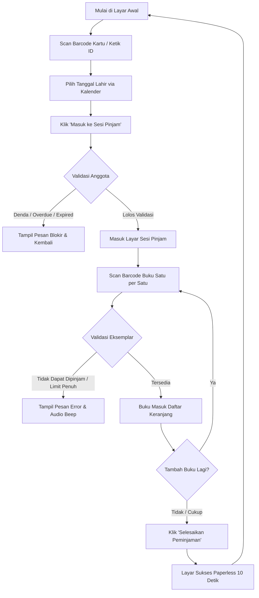

# SLiMS Self-Checkout (Peminjaman Mandiri)

Plugin **Pinjam Mandiri (Self-Checkout)** mandiri untuk **SLiMS 9 Bulian**. Dirancang khusus untuk komputer peminjaman mandiri perpustakaan yang dilengkapi barcode scanner USB/Wireless, memungkinkan pemustaka meminjam buku secara mandiri tanpa memerlukan staf sirkulasi di depan layar.

---

## 🌟 Fitur Utama

1. **Layar Publik Pinjam Mandiri (Full-Screen Kiosk)**
   - Rute mandiri: `index.php?p=pinjam_mandiri`.
   - Layout bersih, modern, dan kontras tinggi tanpa header/footer pencarian buku OPAC.
   - Responsif untuk berbagai resolusi monitor layar sentuh (*touchscreen*) maupun monitor komputer desktop standar.

2. **Autentikasi Pemustaka Cepat & Aman**
   - **ID Anggota**: Kolom input auto-focus siap menerima pemindaian barcode dari kartu anggota (atau input keyboard).
   - **Verifikasi Tanggal Lahir (`birth_date`)**: Menggunakan interaksi kalender (*Date Picker*), mengatasi kendala anggota yang belum memiliki atau lupa password OPAC.

3. **Validasi & Proteksi Sirkulasi Lengkap**
   - Pengecekan masa aktif kartu anggota (`expire_date` & status `is_pending`).
   - Pengecekan kuota maksimal peminjaman berdasarkan tipe anggota (`loan_limit`).
   - **Blokir Otomatis**: Menolak peminjaman jika anggota memiliki buku terlambat (*overdue*) atau tunggakan denda (`debet > credit`), dengan instruksi ramah untuk melapor ke meja sirkulasi.
   - Pengecekan ketersediaan eksemplar (status buku referensi `no_loan`, sedang dipinjam orang lain, atau dalam reservasi).
   - Perhitungan tanggal jatuh tempo otomatis yang melompati hari libur operasional perpustakaan (`holiday`).

4. **Alur Scan Keranjang (Batch Review)**
   - Buku yang di-scan langsung masuk ke daftar pratinjau sementara di layar.
   - Pemustaka dapat meninjau judul buku, nomor panggil (*call number*), dan estimasi tanggal kembali, serta dapat menghapus item jika salah scan sebelum konfirmasi final.

5. **Fitur Perpanjangan Buku Mandiri (Renewal) Hybrid**
   - **Tab Pinjaman Aktif (1-Klik)**: Pemustaka dapat melihat daftar buku yang sedang dipinjam beserta tanggal jatuh tempo, sisa kuota perpanjangan, dan tombol aksi perpanjang langsung.
   - **Scan Barcode Cerdas**: Jika pemustaka men-scan barcode buku yang sedang ia pinjam, sistem otomatis memunculkan modal dialog konfirmasi perpanjangan secara mulus.
   - **Validasi Sirkulasi Penuh**: Mengikuti aturan resmi SLiMS untuk batas maksimal perpanjangan (`reborrow_limit`), pengecekan buku terlambat (*overdue*), reservasi pemustaka lain, dan lompat hari libur perpustakaan.

6. **Audio Synthesizer Terintegrasi (Web Audio API)**
   - Nada *beep* konfirmasi ramah saat scan sukses.
   - Nada *warning beep* saat terjadi penolakan atau scan error.
   - Tanpa ketergantungan file audio eksternal (`.mp3`/`.wav`).

7. **Paperless & Auto-Reset**
   - Layar konfirmasi transaksi sukses menampilkan ringkasan buku dan tanggal jatuh tempo.
   - Ramah lingkungan, tanpa printer thermal.
   - Timer otomatis 10 detik kembali ke layar awal untuk pemustaka berikutnya.

8. **Keamanan Sesi (Inactivity Timeout)**
   - Peringatan otomatis jika layar tidak disentuh selama waktu tunggu (default: 90 detik).
   - Hitung mundur 10 detik dengan opsi lanjutkan sesi atau keluar otomatis demi melindungi akun pemustaka.

9. **Pengaturan Petugas Sirkulasi di Admin**
   - Pustakawan dapat memilih akun staf/petugas pencatat transaksi (`uid`) langsung dari menu Sirkulasi Admin.
   - Menjaga kebersihan laporan statistik sirkulasi harian.

10. **100% Pure Plugin (Zero Core Mutation)**
    - Seluruh kode terisolasi penuh di dalam direktori plugin ini.
    - Nol modifikasi pada file core SLiMS, nol modifikasi skema database inti. Portabel dan aman diperbarui kapan saja.

---

## 📋 Persyaratan Sistem

- **SLiMS**: SLiMS 9 Bulian (v9.4.0 ke atas direkomendasikan).
- **PHP**: PHP 7.4, 8.0, 8.1, atau 8.2.
- **Database**: MariaDB 10.3+ atau MySQL 5.7+.
- **Perangkat Keras (Opsional / Direkomendasikan)**:
  - 1 unit PC / Mini PC / Tablet Windows untuk Pinjam Mandiri.
  - Barcode Scanner USB / Wireless (mode keyboard wedge / HID).

---

## 🚀 Panduan Instalasi

1. **Salin Folder Plugin**
   Letakkan folder `slims_self_checkout` ke dalam direktori plugin SLiMS Anda:
   ```text
   slims_root/
   └── plugins/
       └── slims_self_checkout/
           ├── slims_self_checkout.plugin.php
           ├── config.json
           ├── lib/
           ├── pages/
           └── README.md
   ```

2. **Aktifkan Plugin di Admin SLiMS**
   - Masuk ke Admin SLiMS sebagai pustakawan/administrator.
   - Buka menu **Sistem** (`System`) -> **Plugin** (`Plugins`).
   - Cari plugin **SLiMS Self-Checkout (Peminjaman Mandiri)**.
   - Klik tombol **Aktifkan** (`Activate`).
   - Tautan langsung `Buka Pinjam Mandiri (index.php?p=pinjam_mandiri)` langsung tersedia di kolom keterangan plugin agar pustakawan dapat mengakses layar pinjam mandiri dengan 1 klik.

---

## ⚙️ Panduan Konfigurasi Admin

Setelah plugin aktif, menu baru akan muncul di modul Sirkulasi:

1. Buka menu **Sirkulasi** (`Circulation`) -> **Pengaturan Pinjam Mandiri**.
2. Konfigurasikan opsi berikut:
   - **Petugas Pencatat Sirkulasi**: Pilih akun staf (misalnya akun khusus `kiosk` atau staf sirkulasi aktif). Seluruh transaksi mandiri akan dicatat atas nama akun ini.
   - **Nama Perpustakaan / Judul Kiosk**: Judul yang tampil di layar sambutan pemustaka.
   - **Batas Waktu Idle (Detik)**: Waktu tanpa aktivitas sebelum modal peringatan muncul (default: `60` detik).
   - **Durasi Layar Sukses (Detik)**: Waktu jeda tampilan sukses sebelum kembali ke layar awal (default: `10` detik).
3. Klik **Simpan Pengaturan**.

---

## 🖥️ Panduan Operasional Pinjam Mandiri

Untuk menyiapkan komputer peminjaman mandiri di perpustakaan:

### 1. Membuka Halaman Pinjam Mandiri
Buka peramban (*web browser*) di komputer peminjaman mandiri dan akses URL:
```text
http://<ip-atau-domain-slims>/index.php?p=pinjam_mandiri
```

### 2. Menjalankan Mode Layar Penuh (Kiosk Mode)
Agar pemustaka tidak menutup browser atau membuka aplikasi lain:
- **Cara Cepat**: Tekan tombol `F11` pada keyboard untuk mode Full Screen.
- **Cara Otomatis (Google Chrome / MS Edge Kiosk Mode)**:
  Buat shortcut browser di Desktop dengan target:
  ```cmd
  chrome.exe --kiosk "http://localhost/bulian/index.php?p=pinjam_mandiri" --incognito --disable-pinch
  ```
  *(Atau ganti `chrome.exe` dengan `msedge.exe`)*.

---

## 📖 Alur Penggunaan oleh Pemustaka



1. **Masuk Sesi**:
   - Pemustaka mendekatkan barcode kartu anggota ke scanner (atau mengetik ID).
   - Memilih tanggal lahir pada kalender interaktif.
   - Menekan tombol **Masuk ke Sesi Pinjam**.
2. **Scan Buku**:
   - Input barcode buku otomatis aktif dan siap menerima scan.
   - Setiap scan berhasil, buku muncul di tabel keranjang dan terdengar nada konfirmasi.
   - Jika ingin membatalkan satu buku, klik tombol **Hapus** di samping baris buku terkait.
3. **Konfirmasi & Selesai**:
   - Pemustaka menekan tombol **Selesaikan Peminjaman**.
   - Layar menampilkan daftar buku yang berhasil dipinjam beserta tanggal harus kembali (*due date*).
   - Setelah 10 detik (atau jika pemustaka menekan **Selesai Sekarang**), sesi tertutup dan kembali siap untuk pemustaka berikutnya.

---

## 🔒 Kebijakan Keamanan & Integritas Data

- **Peminjaman Atomik (Database Transaction)**: Transaksi peminjaman multi-buku dieksekusi dalam satu transaksi PDO. Jika terjadi kegagalan sistem di tengah proses, seluruh data di-*rollback* secara utuh sehingga data sirkulasi tetap konsisten.
- **Audit Trail Standar SLiMS 9**: Transaksi otomatis dicatat pada dua tabel: `loan` dan `loan_history`, sesuai standar penulisan modul sirkulasi SLiMS 9 Bulian.
- **Perhitungan Hari Libur**: Mengintegrasikan tabel master `holiday` (libur reguler/mingguan dan libur tanggal khusus), memastikan anggota tidak dibebani tanggal kembali pada hari libur perpustakaan.

---

## 📂 Struktur Berkas

```text
slims_self_checkout/
├── slims_self_checkout.plugin.php   # Entry point plugin & registrasi menu
├── config.json                      # Konfigurasi aktif (UID petugas, timeout, nama perpus)
├── README.md                        # Dokumentasi ini
├── lib/
│   └── CheckoutEngine.php           # Core logic: auth, kalkulasi libur, validasi, transaksi loan
└── pages/
    ├── kiosk.php                    # Halaman frontend kiosk publik
    ├── api.php                      # Endpoint AJAX JSON handler
    └── settings.php                 # Halaman pengaturan sirkulasi di admin
```

---

## 📄 Lisensi & Kontributor

- **Lisensi**: GNU General Public License v3.0 (GPL-3.0) — sejalan dengan lisensi SLiMS.
- **Author**: Gusnaldi Kristiadi Syah
- **Versi**: 1.0.0
